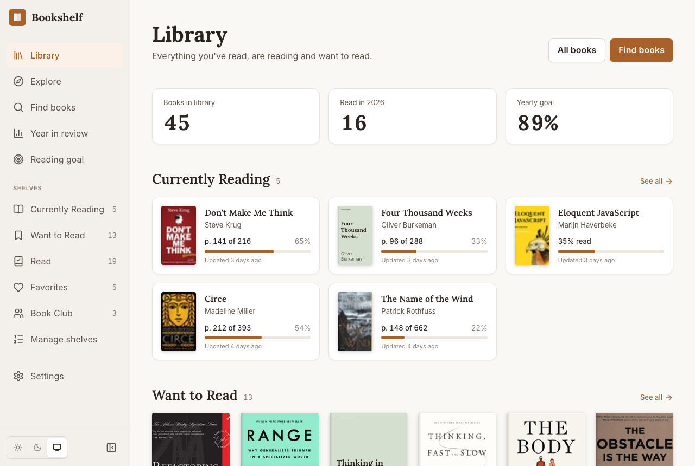

# Bookshelf

A personal reading tracker: search for books, organize them into shelves, track reading progress, set a yearly goal, and look back on your reading year.

**Live URL:** <https://personal-reading-list-phi.vercel.app/> · jump straight in at [`/library`](https://personal-reading-list-phi.vercel.app/library)



This is my solution to the [Frontend Mentor](https://www.frontendmentor.io) **Bookshelf** Product Challenge, built on the **frontend-only** path: no accounts, no backend. Everything lives in the browser.

---

## Overview

Opening the app drops you straight into a library pre-filled with 45 real books across shelves, with reading progress, ratings, notes and a yearly goal, so there is something to explore from the first click. From there you can:

- **Find books** on Open Library by title, author or ISBN, and add them to any shelf in one action.
- **Explore** what is trending, or add a hand-picked starter pack in one click.
- **Organize** books across the three default shelves plus your own, and sort or filter any list.
- **Track progress** on the book you are reading, and be asked, not told, when it is time to mark it finished.
- **Set a yearly goal** and see whether you are ahead of, on, or behind pace.
- **Review your year**: books per month, genres, standout reads, and a cover wall.
- **Start over** whenever you like: clear the library, or restore the sample.

### Tech Stack

| Layer | Technology |
|-------|-----------|
| Framework | Vue 3 (Composition API, `<script setup>`) + Vite, TypeScript |
| State | Pinia |
| Persistence | IndexedDB via [`idb`](https://github.com/jakearchibald/idb), written through from an in-memory store |
| Authentication | None (frontend-only path) |
| Book API | [Open Library](https://openlibrary.org/developers/api) (search, works, trending, covers) |
| Hosting | Vercel (static SPA with a rewrite to `index.html`, see `vercel.json`) |
| Styling | Tailwind CSS v4 with the brand-kit tokens, [reka-ui](https://reka-ui.com) primitives, `class-variance-authority`, Lucide icons |
| Fonts | Lora (headings, reading text) and Inter (UI), self-hosted variable fonts |
| Charts / viz | Hand-built with CSS and SVG, no charting library |
| Testing | Vitest, Vue Test Utils, `fake-indexeddb` (118 tests) |
| Lint / format | ESLint, oxlint, Prettier |

---

## Design Decisions

These are the product and design choices I made where the spec left room for interpretation.

### Year-in-Review & Reading Insights

<!-- TODO (author): the page below was built without a design conversation. Confirm or change the direction, then fill in the "why" and "differently" parts in your own words. -->

**The problem I was solving:** raw numbers alone are not rewarding, and a light reader should not feel embarrassed next to a heavy one.

**My approach:** a standalone page at `/stats` that opens with a "story" card rather than a table: a headline such as _"16 books read so far in 2026"_, a one-line reading of what that means, and the year-over-year change. Below it: books by month, a genre breakdown, "standout" reads (favorite, longest, shortest, fastest, slowest), author variety, and a wall of every cover finished that year. A year switcher (`?year=2025`) makes past years linkable. "Copy summary" puts a plain-text recap on the clipboard.

- **Tone scales with the reader.** Copy changes with the count (one book gets _"Every reading year starts with one good book"_), and the current year says "so far".
- **Nothing is claimed without evidence.** Superlatives appear only when there is something to compare (one book cannot be "the longest"), and a "busiest month" is named only when it truly stands out.
- **A book counts for the year it was finished**, regardless of which shelf it sits on now.

**Why I chose this approach:** <!-- TODO -->

**What I'd do differently:** <!-- TODO -->

### Book Discovery & Recommendations

**The problem I was solving:** a search box is not discovery, and a brand-new reader with an empty library needs somewhere to start.

**My approach:** a dedicated **Explore** page, plus hints woven into the places a reader would otherwise hit a dead end.

- **Trending only.** Explore shows what readers are picking up on Open Library today, this week or this month. I deliberately left out "because you read X" and genre browsing for now: personalization needs data and tuning, and trending needs neither.
- **Starter packs** solve the cold start. Five curated sets of six books (Classics, Sci-fi & fantasy, Big ideas, For developers, Short & satisfying) go into Want to Read in one click, skipping anything already owned. They come from the bundled sample catalog, so they work offline and always have real covers. For a small library the packs lead the page; otherwise trending does.
- **Empty states point onward.** An empty library greets you with starter packs instead of a wall of zeros; an empty shelf and the empty search page both link to Explore.
- **One click to add, one more to choose a shelf:** the same split button as search ("Want to Read" plus a shelf menu), and books already in the library show "On <shelf>" instead of an add button.

**Why I chose this approach:** <!-- TODO -->

**What I'd do differently:** <!-- TODO -->

### Reading Progress Tracking UX

**The problem I was solving:** progress tracking only works if updating it is nearly effortless.

**My approach:** a single control on the book you are reading, shared by the detail view and the library overview.

- An **"I'm on page ___"** field with quick **+10 / +25 / +50** buttons (percent-only books get **+5 / +10 / +25**), instead of a slider or session logging.
- At 100% a **celebration card** appears ("You finished …", pages, days taken, star rating) with **Move to Read** and **Not yet**. The book is never moved automatically.
- The only extra shown next to the bar is **pages left**. No ETA or pace forecast.
- Updates are optimistic: the bar moves immediately and rolls back if saving fails.

**Why I chose this approach:** <!-- TODO -->

**What I'd do differently:** <!-- TODO -->

### Other Design Choices

- **Landing page:** a single "Open My Library" call to action, since the frontend-only path has no sign-up and no guest mode to choose between.
- **Reading goal:** a progress ring with a tick marking where a steady reader would be today (24 books by 1 July is about 12). Within one book of that line counts as "on track". When behind, the page says how many books a month would catch you up. Finishing the goal gets its own celebration card, and a missing goal shows an invitation instead of an empty dashboard.
- **Shelves:** reordering uses up/down buttons rather than drag-and-drop, which keeps it fully keyboard-accessible. Deleting a custom shelf moves its books to Want to Read, so nothing is ever lost with a shelf.
- **Sort and filter live in the URL** (`?sort=rating&genre=Fiction`), so a view survives a reload, works with the back button, and can be shared. A virtual **All books** shelf applies the same controls across the whole library.
- **A shared genre vocabulary.** Genres come from two very different sources (hand-curated sample data and messy Open Library subjects). One normalizer merges synonyms, folds over-specific tags into their parent, and resolves umbrella tags like "Sci-Fi & Fantasy" so books are not double-counted. It also migrates libraries saved by earlier versions.
- **Dark mode** follows the system by default with a manual override, and the theme is resolved before first paint so there is no flash of the wrong one.
- **Everything is reversible or confirmed.** Destructive actions (removing a book, deleting a shelf, clearing the library) ask first and say exactly what will be lost.

---

## Book Data: Handling a Messy API

- **Rate limiting and caching:** requests to Open Library are throttled to one per second, cached in an LRU cache (15 minutes), time out after 10 seconds, and fail with typed errors that map to specific, human messages (offline, timeout, rate-limited, unavailable) rather than a generic "something went wrong".
- **Missing covers** get a styled placeholder in a deterministic color per title. Large covers load progressively: the medium image shows first and the sharp one fades in over it.
- **Duplicates:** a book's identity is matched by Open Library work, ISBN, or normalized title and author, so a different edition of a book you own is recognized.
- **Messy fields:** author names in any of several formats are parsed into one; titles split from subtitles; descriptions have HTML entities and source sections stripped; page counts and ISBNs are optional everywhere.
- **Percent-based progress** is the fallback for books with no page count.

---

## Accessibility

Skip link; page headings take focus after navigation; native `<select>` and `<form>` controls where possible; visible focus rings; all interactive elements are real buttons or links; dialogs are focus-trapped (reka-ui); a polite live region announces changes (_"Added Dune to Want to Read"_, _"Goal set to 24 books"_) and result counts; charts expose their data as text; `prefers-reduced-motion` is respected.

---

## Development Journey

<!-- TODO (author): these sections are yours to write. Prompts are in each comment. -->

### Initial Approach vs. Final

<!-- What was your initial plan? What changed as you built? -->

### Decisions Reconsidered

<!-- What seemed right at first but needed rethinking? -->

### What Surprised Me

<!-- What was harder or easier than expected? -->

### Session Breakdown

| Session | Focus | What I Accomplished |
|---------|-------|-------------------|
| 1 | | |

---

## AI Collaboration Reflection

<!-- TODO (author): How you used AI, what worked, what you learned, and where you pushed back. This section is meant to be in your own voice. -->

### How I Used AI

### What Worked Well

### What I Learned

### Where I Pushed Back

---

## Differentiators

<!-- TODO (author): none chosen yet. Pick 1-2 from the challenge's differentiators (e.g. Reading Statistics Dashboard builds on the year-in-review work) and describe them here. -->

---

## Self-Assessment

<!-- TODO (author): rate honestly once deployed. Left blank on purpose: these are your judgments. -->

| Category | Rating | Notes |
|----------|--------|-------|
| **Works for real users** | /5 | |
| **Book API integration** | /5 | |
| **Design-it-yourself features** | /5 | |
| **Design quality** | /5 | |
| **Responsive design** | /5 | |
| **Performance** | /5 | |
| **Accessibility** | /5 | |
| **Edge case handling** | /5 | |
| **Code quality** | /5 | |
| **Landing page** | /5 | |
| **Guest experience** | /5 | |

### Lighthouse Scores

<!-- TODO: re-measure on the deployed site after the accessibility/SEO fixes ship, then fill in. -->

_To be re-measured on the deployed site._

| Category | Score |
|----------|-------|
| Performance | |
| Accessibility | |
| Best Practices | |
| SEO | |

### Strengths

<!-- TODO (author) -->

### Areas for Improvement

<!-- TODO (author) -->

---

## Known Limitations

- **Single browser, single user.** Data lives in IndexedDB: no sync between devices, and clearing site data erases the library. (There is no export yet.)
- **Trending books arrive without page counts or ISBNs.** The description and genres are filled in after adding, but page count stays empty, so progress for those books is percent-based until it is set.
- **Genre vocabulary is a hand-built mapping.** Unusual Open Library subjects fall through as-is, and a few merges (Mythology to Fantasy, Decision Making to Self-Improvement) are judgment calls.
- **Shelves reorder with buttons, not drag-and-drop.**
- **Not built yet (Stretch):** Goodreads CSV import, search within the library, editable genre tags, activity timeline, bulk actions.

---

## Running Locally

Requires Node 24 (see `.nvmrc`).

```bash
git clone <this-repo>
cd personal-reading-list
npm install

npm run dev          # start the dev server
npm run test:unit    # run the tests
npm run type-check   # vue-tsc
npm run lint         # oxlint + eslint
npm run build        # type-check + production build into dist/
npm run preview      # serve the production build
```

### Environment Variables

None. Open Library needs no API key and the app has no backend.

### Project Layout

```
src/
├── components/     UI by feature: book, explore, goal, layout, search, shelf, stats, ui
├── composables/    Reusable reactive logic (search, trending, browse state, theme…)
├── data/           Sample-library seed and starter packs
├── lib/            Pure, tested logic: stats, goal pace, genres, sorting, normalization…
├── services/       Open Library client and the storage layer (IndexedDB / in-memory)
├── stores/         The Pinia library store
├── views/          One component per route
└── __tests__/      Unit tests
data/               Sample books (JSON + CSV)
```

The storage layer sits behind a small `LibraryStorage` interface, so swapping IndexedDB for a remote database later means adding one implementation.

---

## Acknowledgments

Built as a [Frontend Mentor Product Challenge](https://www.frontendmentor.io). Book data and covers from [Open Library](https://openlibrary.org).
